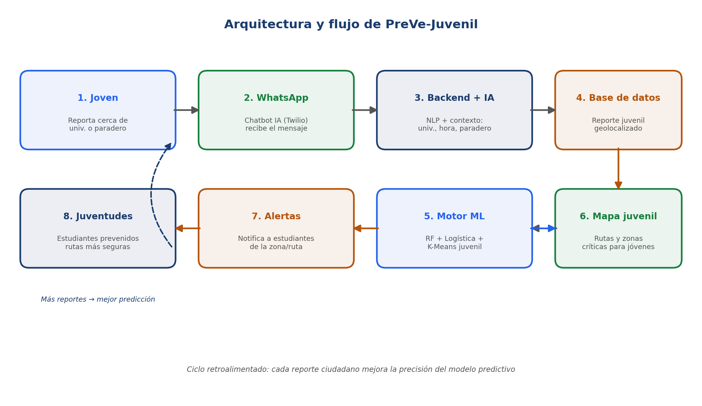
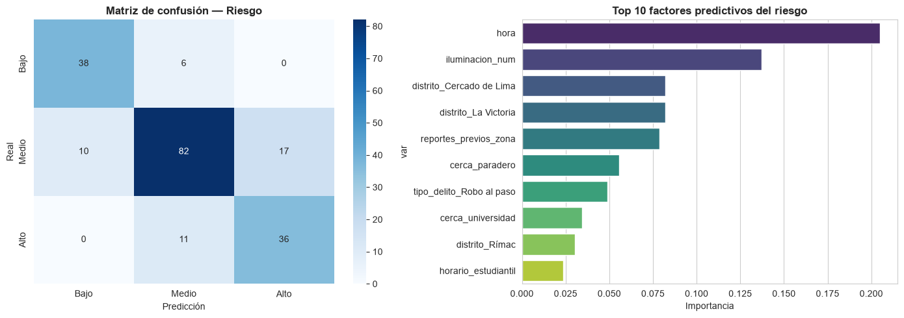
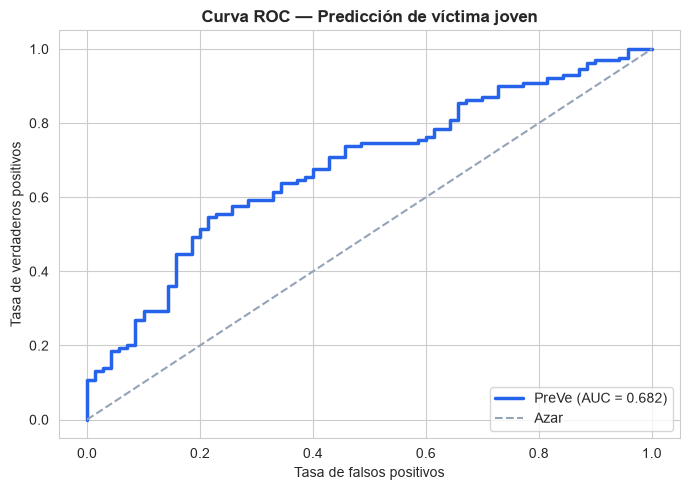
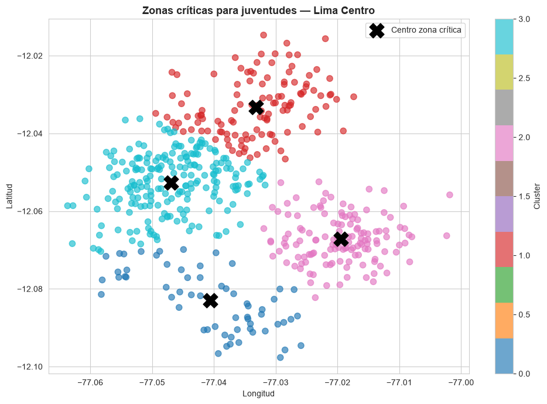
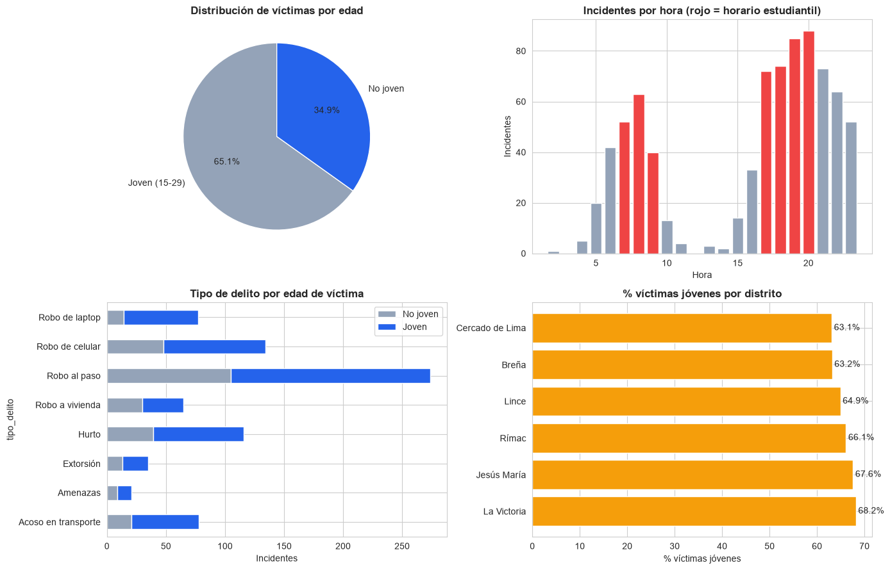

<div align="center">

**English** · [Español](README.es.md)

# 🛡️ PreVe — Predictive Safety System for Urban Youth

**RedPública Hackathon (UNDP) — Citizen Security Edition**
Team **Minsky Devs** · Universidad Peruana de Ciencias Aplicadas (UPC)

<br>

[](https://fcarruitero24.github.io/preve-hackathon-redpublica/)

**[fcarruitero24.github.io/preve-hackathon-redpublica](https://fcarruitero24.github.io/preve-hackathon-redpublica/)**

<br>


</div>

---

## What is PreVe?

PreVe is a citizen platform that **anticipates** risky areas, routes and times
for young people aged 15 to 29 in central Lima, turning citizen reports into
early warnings **before** a crime happens.

Unlike existing safety apps, which are reactive and aimed at the general public,
PreVe combines three attributes:

- **Predictive, not reactive.** It uses machine learning to anticipate risk.
- **Focused on youth.** Aligned with UNDP's mandate of youth leadership.
- **Frictionless.** It works through WhatsApp, with no app to download.

### The problem

- Only **16.1%** of crime victims in Peru report the crime (INEI, 2024).
  This under-reporting makes effective prevention hard to design.
- In Metropolitan Lima, **18 out of every 100 people** were victims of robbery
  between September 2025 and February 2026 (INEI, 2026).
- University students are frequent targets on their daily commutes
  (university–bus stop–work), with documented cases at Universidad de Lima,
  PUCP, UTP and UCH.

---

## Architecture

<div align="center">

</div>

| Component | Technology | Function |
|---|---|---|
| **AI chatbot on WhatsApp** | Twilio API + NLP | Receives reports in natural language and extracts location, time and type of crime |
| **Web platform + heat map** | React (PWA) + Google Maps API | Shows critical routes and areas in real time |
| **ML prediction engine** | Python + scikit-learn | Random Forest, Logistic Regression and K-Means predict risk and trigger alerts |

Every citizen report feeds the model: **more reports → better predictions**.

---

## Prototype results

> Figures measured by running [`notebooks/PreVe_Juvenil_ML.ipynb`](notebooks/PreVe_Juvenil_ML.ipynb)
> on the 800 incidents in the dataset. The notebook includes all outputs.

### Model 1 — Random Forest: classifying the risk level

**Accuracy: 78.0%** on 200 test incidents (3 classes: Low / Medium / High).

| Class | Precision | Recall | F1 | Cases |
|---|:--:|:--:|:--:|:--:|
| Low | 0.79 | 0.86 | 0.83 | 44 |
| Medium | 0.83 | 0.75 | 0.79 | 109 |
| High | 0.68 | 0.77 | 0.72 | 47 |

<div align="center">

</div>

**The most important factors are operational, not demographic:**

| Factor | Importance |
|---|:--:|
| Time of day | **20.5%** |
| Street lighting in the area | **13.7%** |
| District (Cercado de Lima) | 8.2% |
| District (La Victoria) | 8.2% |
| Previous reports in the area | 7.9% |
| Proximity to a bus stop | 5.6% |

The fact that time and lighting dominate is the most actionable signal of the
project: **they are the two variables a municipality can act on directly**
(patrols by time slot and street-light maintenance) without changing anything
structural.

### Model 2 — Logistic Regression: will the victim be young?

**AUC-ROC: 0.682** · accuracy 63.0%

<div align="center">

</div>

| Class | Precision | Recall | F1 |
|---|:--:|:--:|:--:|
| Not young | 0.48 | 0.70 | 0.57 |
| Young | 0.79 | 0.59 | 0.68 |

**This is the weakest model of the set, and it is worth saying so.** An AUC of
0.682 is above chance (0.5) but far from reliable, and the 0.48 precision for
the "Not young" class means that **when it predicts the victim will not be
young, it is right less than half the time**. It works as a complementary
signal, not as a decision criterion.

### Model 3 — K-Means: critical areas for young people

<div align="center">

</div>

| Zone | Incidents | Main district | Average time | % near a university |
|:--:|:--:|---|:--:|:--:|
| 3 | **207** | Cercado de Lima | 15:47 | 58.0% |
| 2 | 134 | La Victoria | 15:42 | 53.0% |
| 1 | 119 | Rímac | 15:46 | **60.5%** |
| 0 | 61 | Lince | 15:42 | 47.5% |

**Two honest caveats about this result:**

1. **The 4 zones were not "detected", they were requested.** The model runs
   with `n_clusters=4`, a parameter set by hand. A rigorous analysis would
   choose the optimal number with the elbow or silhouette method.
2. **The clustering is purely geographic.** It groups only by latitude and
   longitude, so the four zones share the same predominant crime (street
   robbery) and practically the same average time (~15:45). They separate
   *where*, not *how* or *when*.

Even so, the result is useful: it identifies the four geographic hotspots where
resources should be concentrated, and confirms that **between 47% and 60% of
incidents with young victims happen near universities**.

### Usage simulation

The notebook ends by applying both models to a new report: Friday 19:00,
La Victoria, poor lighting, 7 previous reports, near a university and a bus stop:

```
Predicted risk level: 🔴 High
Probability of affecting a young person: 74%
>> ACTION: Immediate preventive alert to registered students in La Victoria.
```

---

## Exploratory analysis

<div align="center">

</div>

---

## Repository structure

```
preve-hackathon-redpublica/
├── index.html                         ← interactive demo (published on GitHub Pages)
├── notebooks/
│   ├── PreVe_Juvenil_ML.ipynb         ← the 3 models, with outputs included
│   └── requirements.txt
├── data/
│   ├── incidentes_juvenil.csv         ← synthetic dataset (800 incidents)
│   ├── Datos_PreVe_Juvenil.xlsx       ← districts, crimes, youth vulnerability
│   ├── Datos_Lima_Centro.xlsx         ← reports, types of crime, victimization
│   └── Presupuesto_PreVe.xlsx         ← detailed budget (8 sheets, S/ 10,000)
├── docs/                              ← application documents (Word, in Spanish)
│   ├── Punto_A_Problema.docx
│   ├── Punto_B_Solucion.docx
│   ├── Anexo2_Puntos_B_C_E.docx
│   ├── Anexo_Analisis_Detallado.docx
│   └── Indice_Fuentes_Datos.docx
└── assets/                            ← diagram and exported charts
```

---

## How to use each part

### Interactive demo

**[Open it in your browser](https://fcarruitero24.github.io/preve-hackathon-redpublica/)**,
no installation, account or external service required. It includes:

- A simulated WhatsApp chat to report an incident in natural language.
- A heat map of central Lima with university areas marked.
- An **automatic simulation** button to see the full flow without typing.
- An alert system that triggers after 3 reports in the same area.

You can also open `index.html` directly after cloning the repository.

### Machine learning notebook

```bash
pip install -r notebooks/requirements.txt
jupyter notebook notebooks/PreVe_Juvenil_ML.ipynb
```

The notebook finds the dataset automatically, so it runs the same from
`notebooks/`, from the repository root or uploaded to Google Colab. All outputs
are already saved: **it can be read on GitHub without running anything**.

### Budget

`data/Presupuesto_PreVe.xlsx` uses native Excel formulas, with no macros.
Sheet 1 is the summary; Sheets 2-6 the detail by item; Sheet 7 the schedule;
Sheet 8 the counterpart contribution and sustainability.

---

## About the data

The figures cited in the application come from official sources: **INEI**
(Victimization in Peru 2024/2025, Crime Statistics), **MININTER**
(National Multisectoral Citizen Security Policy to 2030), **CEPLAN** and the
**Crime and Violence Observatory** (Credicorp/CHS, 2025).

> [!IMPORTANT]
> The `incidentes_juvenil.csv` dataset is **synthetic**, calibrated with real
> trends. It works as a proof of concept of the prediction engine while real
> data is collected during the pilot. The metrics on this page show that the
> pipeline works, not the real behavior of crime in Lima.

See `docs/Indice_Fuentes_Datos.docx` for the full list of downloadable sources
(DATACRIM, SIRTOD, National Crime Report Registry).

---

## Team — Minsky Devs

Five UPC students:

| Role | Degree program |
|---|---|
| Project Lead + Data Scientist | Industrial Engineering |
| Tech Lead / Architect | Software Engineering |
| Backend Developer + Data Engineer | Information Systems Engineering |
| Frontend Developer + UX | Information Systems Engineering |
| QA + Field Coordinator | Information Systems Engineering |

Repository maintained by [Fabrizio Carruitero](https://github.com/fcarruitero24),
project lead.

---

## License

Project developed for academic purposes and for the RedPública Hackathon
application (UNDP), 2026. Educational and social innovation use.
